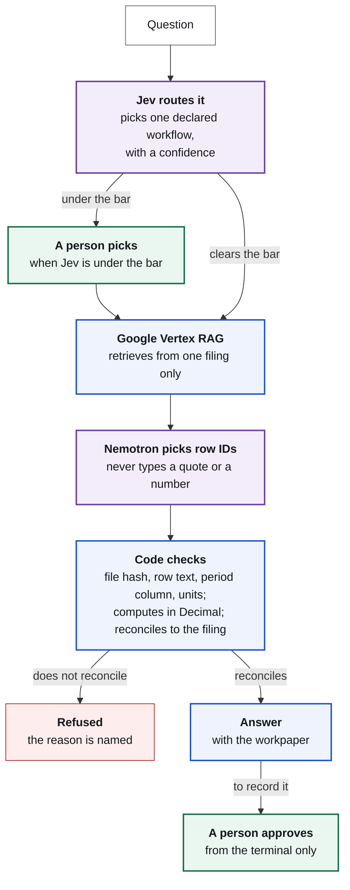

# Finrail

**The model suggests. Code checks every figure against the filing. A person releases.**

Finrail is an agent harness for finance. Every number it gives you is rebuilt from the exact cells of a real filing, in exact decimals, and refused if it does not reconcile. The model is never the one who decides.

**Live demo:** https://finrail-demo-nwoyni5r7q-el.a.run.app


## Why it exists

Anthropic's S-1 (filed 26 October 2026) reports three true profit lines for the same six months:

| Line, six months to 30 June 2026 | Amount |
| --- | ---: |
| Net loss | −$80,748m |
| Operating loss | −$693m |
| Adjusted operating income, as Anthropic presents it | +$1,618m |

An AI that picks one for your memo has made your investment decision for you. In Finrail, which line counts is the fund's method, and the method is code. Under house rule HR-1 (stock compensation is a cost) the same cells give **−$567m**, and the $2,185m gap to Anthropic's figure is explained to the dollar. Ask the harness to add the stock compensation back and it refuses before anything runs.

The same rail catches the quieter mistake. NVIDIA's Q2 FY2027 free cash flow is $21,341m. Ask Finrail to record it as $24,077m and it refuses: that is the operating cash flow line, a real number on the wrong line.

## The core idea

Every step is one of three kinds, and knowing which is which is the design:

| Kind | Decided by | Guarantee |
| --- | --- | --- |
| **Code** | A script: same input, same output | It always runs, or the action never runs. |
| **Judgement** | A model | None, on purpose. This is the work a model is for. |
| **Approval** | A named person | A gate. Nothing is recorded without it. |

Judgement steps are allowed to be wrong, because they sit between code steps that cannot be skipped and an approval that a browser cannot forge.

## How a question flows



Purple is judgement, blue is code, green is a person, red is a refusal.

## Who does what

| Part | Its one job | What it can never do |
| --- | --- | --- |
| **Jev (TypeSafe)** | Reads: picks which workflow answers a question, and which line and period a claim is about, with a confidence | Write text or a number. It picks only from the choices offered. Below the bar, nothing is decided. |
| **NVIDIA Nemotron on Nebius** | Extracts: picks the filing rows for a calculation | Write a quote or do arithmetic. Code attaches the exact row text. |
| **Google Vertex AI RAG Engine** | Retrieves excerpts from seven archived filings | Return a source outside the selected filing. |
| **Tavily** | Finds what the web says about a company | Count as evidence. A web page is a claim to check. |
| **Code** | Decides: checks every figure against the hash-checked archived cell, does the arithmetic, compares claims | Answer without reconciling. There is no fallback. |
| **A person** | Releases a record | Be bypassed by a browser. Approval runs only from the operator's terminal. |

Every Nemotron call is written to the ledger as a `model_call` event, and every Jev call as a `decision_call` event: what the model was shown and what it returned. If the model saw it, it is a record.

## What to try in the demo

Each answer offers the next question as a chip, so the story clicks through:

1. "Did Anthropic make money, according to its S-1?" Three true lines, each with its table and row.
2. "What is Anthropic's operating result under our house rules?" −$567m, with the workpaper.
3. "What does the web say about Anthropic's profit?" Tavily finds press sentences. Jev names the line and period of each. Code gives every verdict: matches, loosely rounded, wrong line, or another period.
4. "Add back stock compensation the way Anthropic does." Refused by HR-1.
5. On the workpaper, "Swap in a figure from another column." Refused by the checker.

The Rules page renders every capability's declared steps from the live registry. The Ledger shows every model and Jev call.

## The capabilities

Each capability is a plugin class that declares its trust rules in code: whether it reads or acts, whether a person must approve, how its result is verified, how a person asks for it, and the steps it runs. The router, the chat trace, the proof page and the Rules page are all drawn from those declarations, so nothing on screen claims more than the code enforces.

| Pack | What it does | The rule it enforces |
| --- | --- | --- |
| `finance.reports` | Seven real filings: quarterly releases from NVIDIA, Nebius and ASML, and Anthropic's S-1. NVIDIA free cash flow and Anthropic's revenue, net loss, operating cash flow, capex and house operating result, rebuilt from the archived cells. Stated figures and web claims checked against them. A price-to-sales multiple at a valuation the person states. | Inputs must match the exact archived cell under the right period column, and the total must equal the figure the issuer reports, or no answer is issued. A recorded figure must equal the checked line, and a person releases it. A multiple is arithmetic on a supplied figure, never advice. |
| `finance.screen` | Public-risk screening across leadership, regulatory, cyber and distress | A deterministic evidence gate is the sole authority for VERIFIED. A quote that is not verbatim in its source is discarded, never repaired. |
| `finance.dataroom`, `finance.compute`, `finance.memo` | Claim check, deterministic metrics and hash-bound memo release over a synthetic data room | Figures must be carried by cited sources. Arithmetic is Python. Release is bound to the memo's hash. |
| `tasks` | A generic non-finance pack | Proves the harness is not finance-only: an unmodified pack runs under the same rules. |

## Quickstart

```bash
git clone https://github.com/0xtigerclaw/finrail
cd finrail
python3 -m venv .venv && . .venv/bin/activate
pip install -e ".[console,dev]"
export FINRAIL_STATE=$PWD/.state FINRAIL_HOME=$PWD/.home
finrail capabilities   # what exists, and the rules each declares
finrail rules          # the same declarations, rendered
pytest                 # offline: no keys, no network
finrail-console        # http://127.0.0.1:8000
```

The tests and the synthetic fixtures run from a fresh clone with no credentials. The live filings, Jev, Nemotron and Tavily paths need their keys: see [docs/public-reports.md](docs/public-reports.md).

Try the wrong figure from a terminal, after one `finance.reports.analyze` run for that quarter:

```bash
finrail do finance.reports.record report_id=NVDA-Q2-FY2027 statement="Record NVIDIA's Q2 free cash flow as \$24,077m"
```

## Check it yourself, without a model

The rules do not depend on a model behaving. These tests feed the checker the wrong figure, the wrong column and a tampered input directly, with no keys and no network, and every one must be refused:

```bash
pytest tests/test_record.py tests/test_anthropic_s1.py::test_tamper_replays_are_refused_by_the_checker tests/test_public_reports.py -k "refused or waits"
```

They include the case above: $24,077m stated as free cash flow is refused and named as the operating cash flow line. Stated as operating cash flow, the same figure passes and waits for a person.

## The console

Ask is a chat on the left with the harness trace for each answer on the right. Filings lists the seven sources and reconciles every indexed file live against the corpus. Proof holds the workpaper and a tamper replay. Ledger shows runs, Nemotron calls and Jev calls. Rules shows every declaration.

Every page shows the `finrail` command that does the same thing from a terminal. The harness is a CLI first, and the console is a shell over the same dispatcher. The console cannot approve anything: the server cannot know who clicked, so its approve route always refuses and names the terminal command.

## Engines

Every model call goes through one entry point, `finrail/core/llm.py`. The engine is configuration, never a code branch.

| Deployment | Configuration |
| --- | --- |
| Nebius (this submission) | `FINRAIL_ENGINE=nebius` and `NEBIUS_API_KEY`. Runs NVIDIA Nemotron (`nvidia/nemotron-3-super-120b-a12b`) on Nebius Token Factory. |
| Meta | `FINRAIL_ENGINE=meta`, `FINRAIL_ENGINE_BASE_URL`, `FINRAIL_ENGINE_API_KEY`, `FINRAIL_MODEL`. Same capabilities, same checks. |
| Local development | The default CLI engine. Never used in a judged deployment. |

There is no silent fallback. If the engine is down or returns something malformed, the run fails under a named error code (`PROVIDER_UNAVAILABLE`, `SCHEMA_INVALID`, `EMPTY_RESPONSE`, `TIMEOUT`, `CONTEXT_WINDOW_EXCEEDED`) instead of quietly answering from another provider.

## Evaluation

198 offline tests, no provider calls. They cover the source-cell checks and a tamper replay, the Anthropic S-1 figures and HR-1, the router bar on workflow, report, period and figure, a Jev pick outside the offered choices being discarded, the record check (operating cash flow stated as free cash flow is refused and named), web claims against stubbed Tavily pages, every Jev call reaching the ledger, the evidence gate (a fabricated quote is discarded, not repaired), the hash-bound memo release, and the engine seam's named failures.

## Honest limitations

- HR-1 is illustrative. A fund's real rules replace it.
- Anthropic is checked for one half-year, the period its S-1 covers. The 36-case benchmark has not been run.
- When Jev is unreachable, plain keyword rules route the question, and the trace says so.
- Capability code runs in-process and is not OS-sandboxed. Agents started inside a person's own login share that person's scope.
- The demo deployment keeps state on one instance's disk. A restart clears its runs.

## Where this sits

An AI-native fund needs four things: capital, compute, context and culture. The first two anyone can buy. Context is the bottleneck: a record where every number carries its source and who stood behind it. Culture is trust, and trust is earned by verification. The thinking is in [Building the Frontier Investment House](https://superagents.substack.com/p/building-the-frontier-investment).

Finrail is the workflow layer on top of that record. Each capability is a command, a contract and an evaluation set: a declared way to ask, a rule in code that must hold, and tests that prove it holds. A new workflow costs those three things, not a new trust story.

## Docs

| | |
| --- | --- |
| [docs/PHILOSOPHY.md](docs/PHILOSOPHY.md) | Why it is shaped this way. Read this first. |
| [docs/ARCHITECTURE.md](docs/ARCHITECTURE.md) | How it is put together. |
| [docs/public-reports.md](docs/public-reports.md) | The filings, the RAG corpus and operator ingestion. |
| [docs/demo-script.md](docs/demo-script.md) | The demo video, beat by beat. |

## A new, standalone project

Finrail was created in October 2026. This repository is complete in itself and depends on no other codebase. DeepSeek Harness, which made everything a plugin, inspired the design. No code is shared.

## Licence

Apache 2.0. See [LICENSE](LICENSE).
