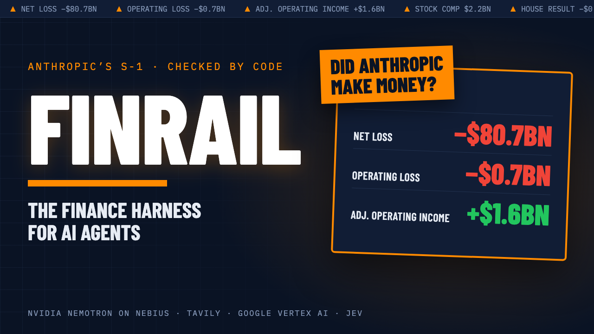
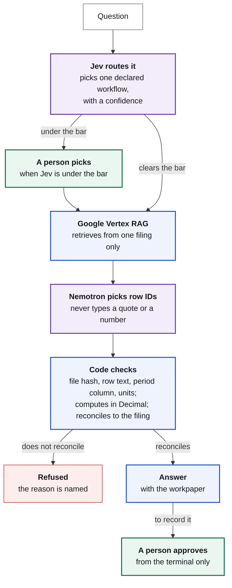
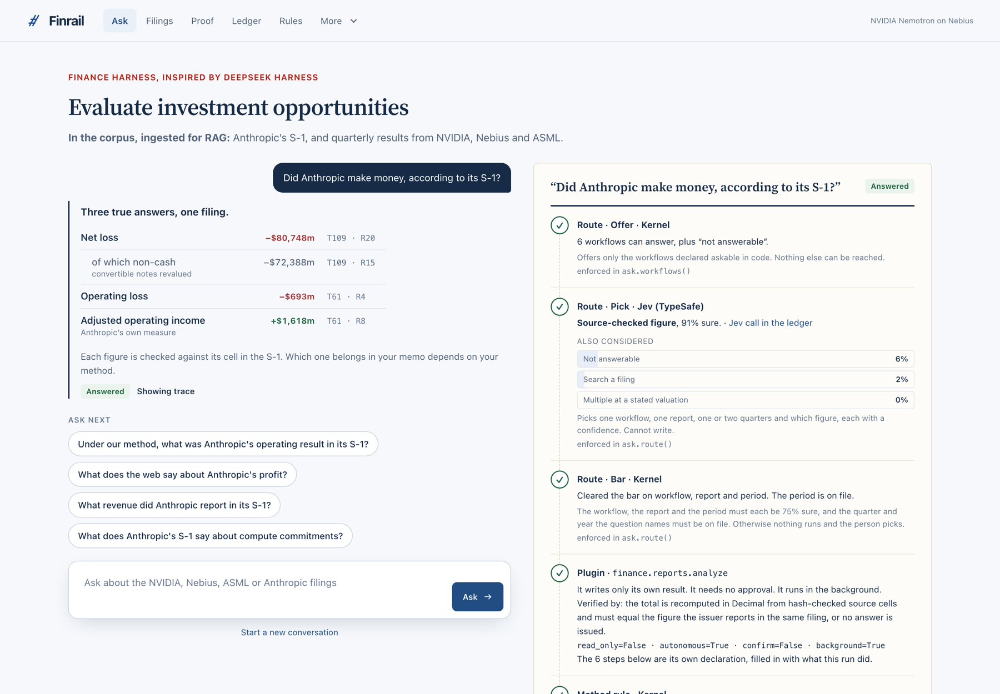
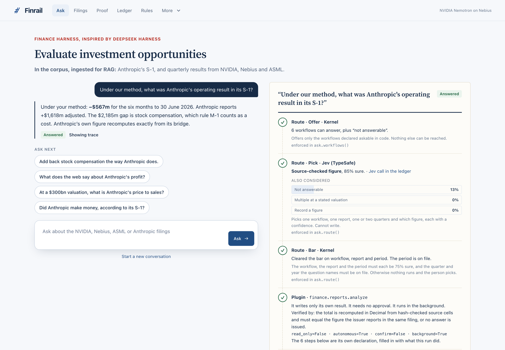
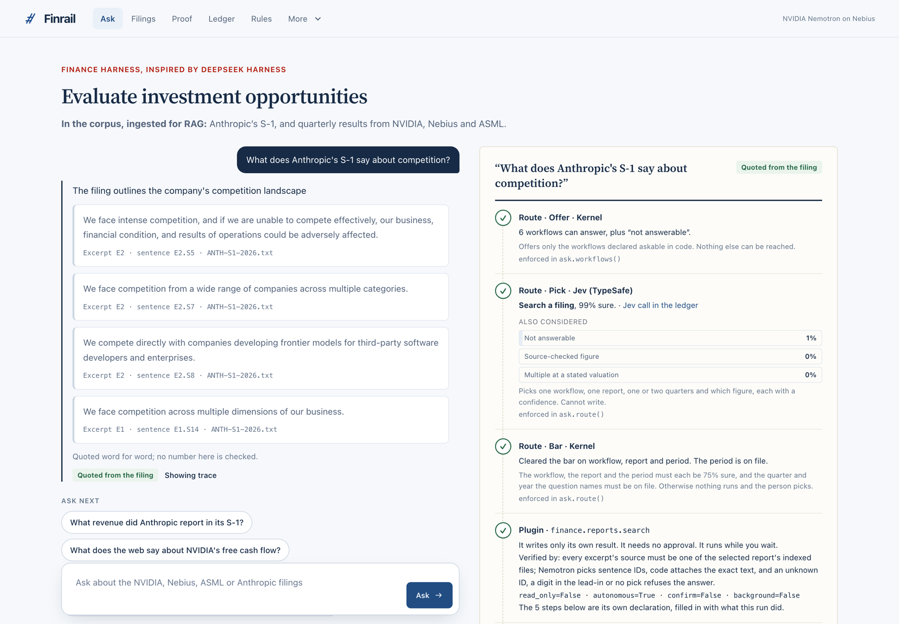
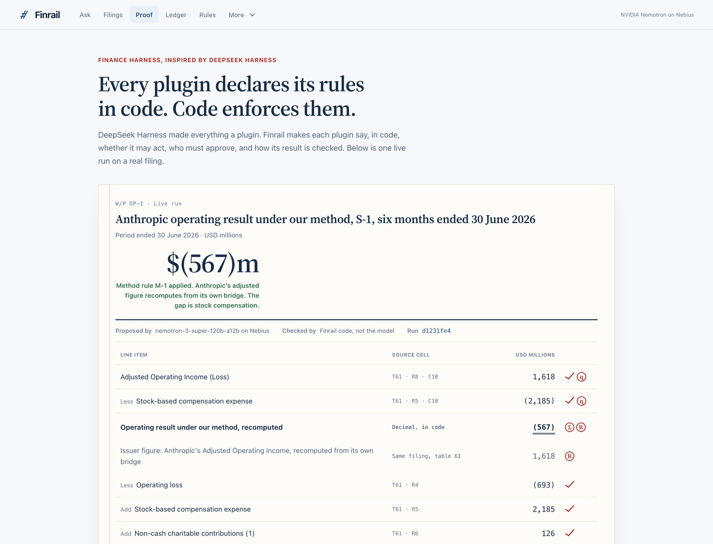
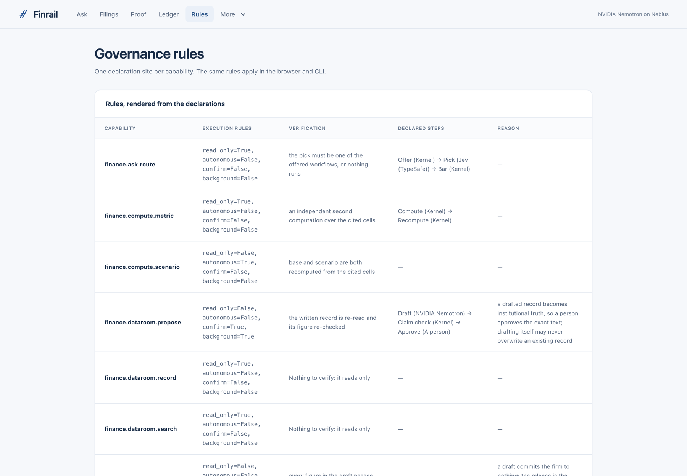
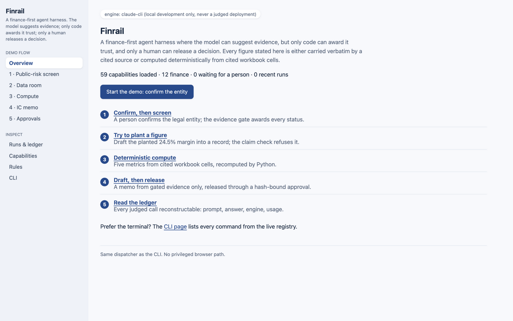
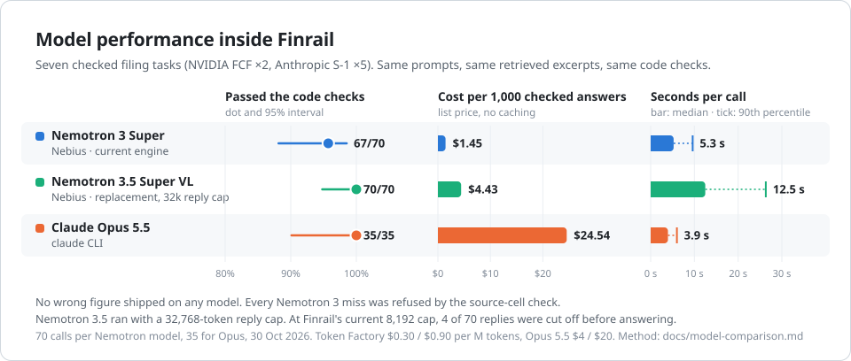

# Finrail



**A harness for financial AI in which every figure is decided by code, checked against its source, and approved only by a person.**

Finrail is built for one domain: finance, where a number is acted on and a fluent wrong number is the most expensive kind. Its design descends from DeepSeek Harness. Every request flows through one deterministic dispatcher. A language model is a function that code calls, with typed inputs and a checked return. The interface is a plugin over that dispatcher, with no authority of its own.

**Live demo:** https://finrail-demo-nwoyni5r7q-el.a.run.app

**Built with:** Sol 6.1, Claude Opus 5.5, NVIDIA Nemotron and GLM-5.3 on Nebius Token Factory. See [How it was built](#how-it-was-built).

## The problem

AI systems are beginning to write the figures that investment decisions rest on. Models are fluent, and fluency is not accuracy. In finance the dangerous error is not the visibly wrong answer. It is the plausible figure from the wrong line, the wrong period or the wrong definition, delivered with confidence.

Two real filings show how easily that happens.

**Example 1: three true answers to one question.** Anthropic's S-1 (filed 26 October 2026) reports three true profit lines for the same six months:

| Line, six months to 30 June 2026 | Amount |
| --- | ---: |
| Net loss | −$80,748m |
| Operating loss | −$693m |
| Adjusted operating income, as Anthropic presents it | +$1,618m |

A model that chooses one of these for an investment memo has made a methodological decision on the fund's behalf, without saying so.

**Example 2: a real number on the wrong line.** NVIDIA's Q2 FY2027 release builds free cash flow from three lines of its cash flow statement:

| Line, three months to 26 July 2026 | Amount |
| --- | ---: |
| Net cash provided by operating activities | $24,077m |
| Purchases related to property and equipment and intangible assets | −$2,677m |
| Principal payments on property and equipment and intangible assets | −$59m |
| **Free cash flow, as NVIDIA reports it** | **$21,341m** |

A model asked for free cash flow that returns $24,077m has quoted a real figure from the filing. It is the operating cash flow line, and it overstates free cash flow by $2,736m. Nothing about the number looks wrong. Only a check against the source, line by line, catches it.

Underneath both examples sits a harder problem: parsing. When models read dense financial tables, multi-column statements and charts, they still misread rows, take the figure from the wrong column, and produce numbers that look right but are not in the source. We have seen this repeatedly, with capable models. A fund or family office that wants to rely on AI-native infrastructure cannot accept that error rate. It needs precise guardrails, and code that verifies every detail of every figure: the source document, the row, the column, the period, the units and the arithmetic.

## The approach

Finrail separates the work into three kinds of step and assigns each to the party able to guarantee it:

| Kind | Performed by | Guarantee |
| --- | --- | --- |
| **Code** | The dispatcher and the checks | Deterministic. It always runs, or the action does not run. |
| **Judgement** | A model, called as a function | None, by design. Its output is a proposal that code verifies. |
| **Approval** | A named person | A gate. Nothing is recorded without it, and no browser can pass it. |

Judgement is permitted to be wrong because it sits between code that cannot be skipped and an approval that cannot be forged. Which profit line belongs in the memo is the fund's method, and the method is code: under method rule M-1 (stock compensation is a cost) the same archived cells give **−$567m**, and the $2,185m difference from Anthropic's figure is reconciled to the dollar. A request to add stock compensation back is refused before anything runs. A request to record $24,077m as NVIDIA's free cash flow is refused and names the line it actually came from.

## Inspired from DeepSeek Harness Architecture

Finrail takes three principles from DeepSeek Harness and extends each for finance. 

| DeepSeek Harness established | Finrail adds, for finance |
| --- | --- |
| **Everything is a plugin.** | Every plugin also declares its trust rules in code: whether it reads or acts, whether a person must approve, how its result is verified (`verified_by`), how a person asks for it (`ask`), and each step it runs with the rule that holds it (`steps`). The router is a plugin. The web console is a plugin. |
| **If the model saw it, it is a record.** | Every model call is written to the run ledger: each Nemotron call as a `model_call` event and each Jev call as a `decision_call` event, with what the model was shown and what it returned. |
| **Canonical failures, no silent fallback.** | A failed engine call fails the run under a named code. A figure that does not reconcile to the filing produces no answer. There is no path on which an unverified number is shown. |

## Three design principles

### 1. Everything flows through code

There is one execution path. The CLI, the web console and scheduled jobs all enter the same dispatcher, which plans a run, validates it against the capability's declared schema, stops for approval where the capability requires it, executes, verifies the result, and records every step in the ledger. No surface has a privileged route around it.

For a financial figure, verification is specific. Code checks the SHA-256 of the archived filing, the exact row text, the period column and the units, recomputes the total in exact decimals, and requires it to equal the figure the issuer reports in the same filing. If any check fails, no answer is issued.

### 2. The model is a function call

A model in Finrail does not drive the system. Code calls it, with a typed request and a declared schema, and treats the return as a proposal:

| Model | Called to | Returns | Never |
| --- | --- | --- | --- |
| **Jev (TypeSafe)** | Route a question; read which line and period a claim refers to | One of the choices offered, with a confidence | Writes text or a number. Below the 75% bar, nothing is decided and a person picks. |
| **NVIDIA Nemotron 3.5 Super on Nebius** (the default engine) | Select the filing rows a calculation needs; answer a filing topic question by picking the sentences that answer it | Row IDs; sentence IDs (such as `E2.S4`) and a one-line lead-in with no digits | Types a quote or performs arithmetic. Code attaches the exact source text, and an unknown ID, a digit in the lead-in or an empty pick refuses the answer. |

Every model call passes through one function, `finrail/core/llm.py`, which enforces the schema and records the call. On the HTTP engines used in deployment, tool use and open-ended sessions are refused under a named error. The other services are retrieval, not judgement: **Google Vertex AI RAG Engine** retrieves excerpts from one selected filing, and **Tavily** finds what the web says, which is treated as a claim to check, never as evidence.

### 3. The interface is a plugin

The web console is a plugin like any other (`finrail/extensions/console`). It declares its own libraries as requirements, so `finrail doctor` reports a missing one. It declares no capabilities and holds no rules: every page is rendered from the registry's declarations and every action dispatches through the same path as the CLI. Its pages are Ask, Filings, Proof, Ledger and Rules, and each shows the `finrail` command that does the same thing from a terminal. Disable the plugin and the console has no surface at all. Approval is the one thing it cannot do: the server cannot know who clicked, so its approve route always refuses and names the terminal command.

## How a question flows



Purple is judgement, blue is code, green is a person, red is a refusal.

## What to try in the demo

Each answer offers the next question as a chip, so the story clicks through:

1. "Did Anthropic make money, according to its S-1?" Three true lines, each with its table and row.
2. "Under our method, what was Anthropic's operating result in its S-1?" −$567m, with the workpaper.
3. "What does the web say about Anthropic's profit?" Tavily finds press sentences. Jev names the line and period of each. Code gives every verdict: matches, loosely rounded, wrong line, or another period.
4. "Add back stock compensation the way Anthropic does." Refused by M-1.
5. On the workpaper, "Swap in a figure from another column." Refused by the checker.

The Rules page renders every capability's declared steps from the live registry. The Ledger shows every model and Jev call.

## Screens

**The opening question.** Three true profit lines from one filing, each with its table and row, and the harness trace beside the answer.



**A figure under the fund's method.** −$567m under rule M-1, with the $2,185m gap to Anthropic's adjusted figure explained. The trace on the right shows each step and the rule that holds it.



**A quoted answer.** Nemotron picks sentence IDs. Code pastes the exact filing text, and refuses the answer if an ID is unknown.



**The workpaper.** Every input traced to its table, row and column in the filing, recomputed in Decimal by code, and reconciled to the issuer's own figure.



**The rules.** Every capability's execution rules, verification and declared steps, rendered from the code that enforces them.



**Console Screen.**



## The capabilities

| Pack | What it does | The rule it enforces |
| --- | --- | --- |
| `finance.reports` | Seven real filings: quarterly releases from NVIDIA, Nebius and ASML, and Anthropic's S-1. NVIDIA free cash flow and Anthropic's revenue, net loss, operating cash flow, capex and operating result under the fund's method, rebuilt from the archived cells. Stated figures and web claims checked against them. A price-to-sales multiple at a valuation the person states. | Inputs must match the exact archived cell under the right period column, and the total must equal the figure the issuer reports, or no answer is issued. A recorded figure must equal the checked line, and a person releases it. A multiple is arithmetic on a supplied figure, never advice. |
| `finance.screen` | Public-risk screening across leadership, regulatory, cyber and distress | A deterministic evidence gate is the sole authority for VERIFIED. A quote that is not verbatim in its source is discarded, never repaired. |
| `finance.dataroom`, `finance.compute`, `finance.memo` | Claim check, deterministic metrics and hash-bound memo release over a synthetic data room | Figures must be carried by cited sources. Arithmetic is Python. Release is bound to the memo's hash. |
| `tasks` | A minimal non-finance pack, kept as a control | Shows that the finance rules live in the finance packs, not in special cases inside the dispatcher. |

## Check it yourself, without a model

The rules do not depend on a model behaving. These tests feed the checker the wrong figure, the wrong column and a tampered input directly, with no keys and no network, and every one must be refused:

```bash
pytest tests/test_record.py tests/test_anthropic_s1.py::test_tamper_replays_are_refused_by_the_checker tests/test_public_reports.py -k "refused or waits"
```

They include the case above: $24,077m stated as free cash flow is refused and named as the operating cash flow line. Stated as operating cash flow, the same figure passes and waits for a person.

## Quickstart

```bash
git clone https://github.com/0xtigerclaw/finrail
cd finrail
python3 -m venv .venv && . .venv/bin/activate
pip install -e ".[console,dev]"
export FINRAIL_STATE=$PWD/.state FINRAIL_HOME=$PWD/.home
finrail capabilities   # what exists, and the rules each declares
finrail rules          # the same declarations, rendered
pytest                 # offline: no keys, no network
finrail-console        # http://127.0.0.1:8000
```

The tests and the synthetic fixtures run from a fresh clone with no credentials. The live filings, Jev, Nemotron and Tavily paths need their keys: see [docs/public-reports.md](docs/public-reports.md).

Try the wrong figure from a terminal, after one `finance.reports.analyze` run for that quarter:

```bash
finrail do finance.reports.record report_id=NVDA-Q2-FY2027 statement="Record NVIDIA's Q2 free cash flow as \$24,077m"
```

## Engines

Every model call goes through one entry point, `finrail/core/llm.py`. The engine is configuration, never a code branch.

| Deployment | Configuration |
| --- | --- |
| Nebius (this submission) | `FINRAIL_ENGINE=nebius` and `NEBIUS_API_KEY`. Runs NVIDIA Nemotron 3.5 Super (`nvidia/Nemotron-3.5-Super-VL`) on Nebius Token Factory, with a 32,768-token reply cap (`FINRAIL_ENGINE_MAX_TOKENS`). Nemotron 3 Super leaves Token Factory serverless on 9 November 2026. |
| Meta | `FINRAIL_ENGINE=meta`, `FINRAIL_ENGINE_BASE_URL`, `FINRAIL_ENGINE_API_KEY`, `FINRAIL_MODEL`. Same capabilities, same checks. |
| Local development | The default CLI engine. Never used in a judged deployment. |

There is no silent fallback. If the engine is down or returns something malformed, the run fails under a named error code (`PROVIDER_UNAVAILABLE`, `SCHEMA_INVALID`, `EMPTY_RESPONSE`, `TIMEOUT`, `CONTEXT_WINDOW_EXCEEDED`) instead of quietly answering from another provider.

## Evaluation

201 offline tests, no provider calls. They cover the source-cell checks and a tamper replay, the Anthropic S-1 figures and M-1, the router bar on workflow, report, period and figure, a Jev pick outside the offered choices being discarded, the record check (operating cash flow stated as free cash flow is refused and named), web claims against stubbed Tavily pages, every Jev call reaching the ledger, the evidence gate (a fabricated quote is discarded, not repaired), the hash-bound memo release, the engine seam's named failures, and the console plugin refusing to start when disabled.

## Model performance

<picture>
  <source media="(prefers-color-scheme: dark)" srcset="docs/img/model-performance-dark.svg">
  
</picture>

The model only picks a source row and a number. Code checks both against the archived filing and does the arithmetic. So a weaker model shows up as refusals, latency and cost, never as a wrong figure.

On seven checked filing tasks, all three models passed at rates that cannot be told apart at this sample size. Nemotron 3.5, Finrail's default engine, did it at about 1/5.5 of Opus's cost per checked answer, and Nemotron 3 at about 1/17. Opus was the fastest. Every wrong pick was refused by code. Nemotron 3.5 needs room to think: with the 32,768-token reply cap Finrail now uses it passed 70 of 70, while at the old 8,192 cap four replies were cut off before they answered. Method, every call and caveats (one domain, 35 to 70 calls per model, retrieval held fixed): [docs/model-comparison.md](docs/model-comparison.md).

## Honest limitations

- M-1 is illustrative. A fund's real rules replace it.
- Anthropic is checked for one half-year, the period its S-1 covers. The 36-case benchmark has not been run.
- When Jev is unreachable, plain keyword rules route the question, and the trace says so.
- Capability code runs in-process and is not OS-sandboxed. Agents started inside a person's own login share that person's scope.
- The demo deployment keeps state on one instance's disk. A restart clears its runs.

## Where this sits

An AI-native fund needs four things: capital, compute, context and culture. The first two anyone can buy. Context is the bottleneck: a record where every number carries its source and who stood behind it. Culture is trust, and trust is earned by verification. The thinking is in [Building the Frontier Investment House](https://superagents.substack.com/p/building-the-frontier-investment).

Finrail is the workflow layer on top of that record. Each capability is a command, a contract and an evaluation set: a declared way to ask, a rule in code that must hold, and tests that prove it holds. A new workflow costs those three things, not a new trust story.

## Docs

| | |
| --- | --- |
| [docs/PHILOSOPHY.md](docs/PHILOSOPHY.md) | Why it is shaped this way. Read this first. |
| [docs/ARCHITECTURE.md](docs/ARCHITECTURE.md) | How it is put together. |
| [docs/public-reports.md](docs/public-reports.md) | The filings, the RAG corpus and operator ingestion. |
| [docs/demo-script.md](docs/demo-script.md) | The demo video, beat by beat. |

## How it was built

The entire build was done with four AI models working together:

- Sol 6.1
- Claude Opus 5.5, from Anthropic
- NVIDIA Nemotron, GLM-5.3 via Nebius Token Factory

These models wrote and reviewed the code. Separately, at runtime, the harness calls two models, each as a function: NVIDIA Nemotron 3.5 Super on Nebius, the default engine, selects filing rows and picks quoted sentences, and Jev (TypeSafe) makes typed choices. Code decides everything else, and a person releases.

## A new, standalone project

Finrail was created in October 2026. This repository is complete in itself and depends on no other codebase. DeepSeek Harness inspired the design. No code is shared.

## Licence

Apache 2.0. See [LICENSE](LICENSE).
